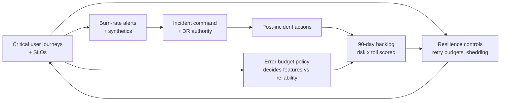
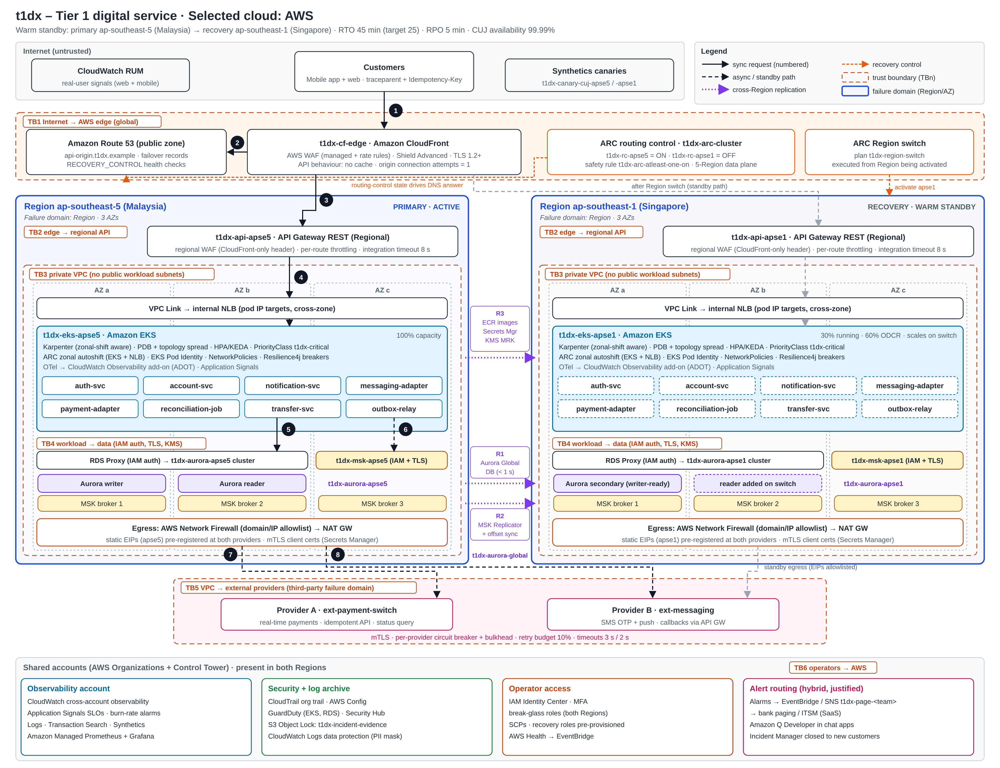

# Tier 1 digital service - SRE assessment

> **Selected cloud: AWS.** All designs, diagrams and code in this repository use AWS only. The non-AWS parts are the two external providers from the scenario and the bank's existing paging/ITSM tool, explained under [Assumptions](#assumptions).

| | |
|---|---|
| Candidate | Siow Chen Wei (Louis) |
| Role | Site Reliability Engineer |
| Submitted | 27 Nov 2026 |
| Primary Region | `ap-southeast-5` Asia Pacific (Malaysia) |
| Recovery Region | `ap-southeast-1` Asia Pacific (Singapore) |
| DR pattern | Warm standby. Failover is decided by a person and executed by ARC Region switch |

---

## Summary

Short version: [EXECUTIVE-SUMMARY.md](EXECUTIVE-SUMMARY.md).

The scenario describes slow detection, retry storms, DR that was never tested and no clear owner for reliability work. I treated these as one problem rather than four separate fixes. Customer journeys and their SLOs come first, because the alerting, the incident process and the roadmap all depend on them.



Main design decisions:

| # | Decision | Reason |
|---|---|---|
| 1 | For CUJ-03, "available" means the transfer is accepted and the customer gets a truthful status. Completion by the payment provider has its own SLO. | We can only commit 99.99% on the part we control. Working is in [02](docs/02-sli-slo-specification.md#1-why-9999-has-to-be-designed-for). |
| 2 | The transactional outbox in Aurora is the source of truth for events, not Kafka. | Takes MSK out of the synchronous write path. After a DR event, missing Kafka messages are re-published from the outbox. |
| 3 | Only one layer retries, capped at 10% of traffic. | The current setup lets every layer retry, which is how one slow dependency turns into 27x load. |
| 4 | Only SLO burn-rate alerts page. Cause alerts become tickets. | Answers "many alerts, slow detection" directly. |
| 5 | Warm standby in Singapore. The Region switch plan runs from the recovery Region. | Meets RTO 45 min and RPO 5 min without the write conflicts of active-active on a ledger. |
| 6 | AZ failures are shifted automatically by ARC zonal autoshift. Regional failover is a human call. | Automatic regional failover on a ledger risks split-brain. A 5-minute decision still fits in the 45-minute RTO. |
| 7 | SRE is governed by the error budget policy, a toil cap and a production readiness review. | Without this, SRE ends up as the ops dumping ground. |

## Architecture diagram (mandatory)



[Full-size PNG](diagrams/architecture.png), [SVG](diagrams/architecture.svg), Source: [`diagrams/src/build_architecture.py`](diagrams/src/build_architecture.py), Walkthrough: [docs/00-architecture-overview.md](docs/00-architecture-overview.md)

## Deliverables

| Required deliverable | Task (weight) | Where |
|---|---|---|
| Executive summary | All | [EXECUTIVE-SUMMARY.md](EXECUTIVE-SUMMARY.md) |
| Architecture overview, trust boundaries, security, cost | All | [docs/00-architecture-overview.md](docs/00-architecture-overview.md) |
| Service reliability model | 1 (20%) | [docs/01-reliability-model.md](docs/01-reliability-model.md) |
| SLI/SLO specification | 1 (20%) | [docs/02-sli-slo-specification.md](docs/02-sli-slo-specification.md), [slo/slo-catalogue.yaml](slo/slo-catalogue.yaml) |
| Observability architecture | 2 (15%) | [docs/03-observability-architecture.md](docs/03-observability-architecture.md) |
| Resilience architecture | 3 (20%) | [docs/04-resilience-architecture.md](docs/04-resilience-architecture.md), [config/](config/), [k8s/](k8s/) |
| DR runbook | 4 (20%) | [docs/05-dr-runbook.md](docs/05-dr-runbook.md) |
| Game-day plan | 4 (20%) | [docs/06-game-day-plan.md](docs/06-game-day-plan.md) |
| Incident command model | 5 (15%) | [docs/07-incident-command.md](docs/07-incident-command.md) |
| Prioritised 90-day roadmap | 6 (10%) | [docs/08-roadmap-90-day.md](docs/08-roadmap-90-day.md) |
| Sample IaC | 2, 3, 4 | [terraform/](terraform/) |
| Sources and AI disclosure | Checklist | [SOURCES.md](SOURCES.md), [AI disclosure](#ai-assistance-disclosure) |

## Repository layout

```
.
├── README.md                    <- start here
├── EXECUTIVE-SUMMARY.md         <- one-page summary
├── SOURCES.md                   <- references + AI disclosure detail
├── docs/                        <- deliverables 00-08
├── diagrams/                    <- architecture.png / .svg + source script
├── slo/slo-catalogue.yaml       <- SLO spec in YAML
├── config/resilience/           <- timeout budget + Resilience4j policy
├── k8s/                         <- EKS workload manifests
└── terraform/
    ├── observability/           <- burn-rate alarms, Synthetics canary
    ├── recovery/                <- ARC routing controls, Route 53 failover, Aurora Global DB
    └── game-day/                <- AWS FIS experiment templates
```

## Naming convention

Diagram, docs and code use the same names.

| Thing | Pattern | Example |
|---|---|---|
| Service prefix | `t1dx` (Tier 1 digital experience) | - |
| Region code | `apse5` = ap-southeast-5, `apse1` = ap-southeast-1 | - |
| Regional resource | `t1dx-<service>-<region>` | `t1dx-eks-apse5`, `t1dx-aurora-apse1`, `t1dx-msk-apse5`, `t1dx-api-apse5` |
| Global resource | `t1dx-<service>-global` | `t1dx-aurora-global`, `t1dx-cf-edge` |
| Recovery controls | `t1dx-arc-*`, `t1dx-rc-<region>` | `t1dx-arc-cluster`, `t1dx-rc-apse5` |
| Region switch plan | `t1dx-region-switch` | - |
| Workloads (EKS) | `<domain>-svc` / `<provider>-adapter` | `auth-svc`, `account-svc`, `transfer-svc`, `payment-adapter`, `notification-svc`, `messaging-adapter`, `outbox-relay`, `reconciliation-job` |
| Kafka topics | `<domain>.<event>.v<n>` | `transfer.events.v1`, `transfer.retry.v1`, `transfer.dlq.v1`, `notification.requests.v1` |
| Journeys | `CUJ-0n` | `CUJ-01` Login, `CUJ-02` View balance, `CUJ-03` Fund transfer, `CUJ-04` Transfer notification |
| External providers | `ext-<role>` | `ext-payment-switch` (Provider A), `ext-messaging` (Provider B) |

## Assumptions

| # | Area | Assumption | If this is wrong |
|---|---|---|---|
| A1 | Business | Retail digital banking on mobile and web: login, balance, fund transfer and notifications. | The CUJs change. The method stays the same. |
| A2 | Providers | Provider A is a real-time payment switch (`ext-payment-switch`). Provider B is an SMS OTP and push aggregator (`ext-messaging`). Both accept our reference as an idempotency key and have a status-query API. | Without idempotent provider APIs the adapters must not retry at all, and reconciliation relies on status queries only. |
| A3 | Regions | Primary `ap-southeast-5` (Malaysia, 3 AZs), DR `ap-southeast-1` (Singapore). Bank Risk/Compliance approves a replica of the critical data set in Singapore under BNM RMiT and the bank's outsourcing policy. | Malaysia has only one AWS Region today. If DR has to stay in Malaysia, the design drops to multi-AZ plus backups and RTO/RPO need to be renegotiated. This is the biggest open risk. |
| A4 | Engine | Aurora PostgreSQL 16.x. Global Database is supported in both Regions (checked, see SOURCES). | Aurora MySQL works the same, except `rds.global_db_rpo` is PostgreSQL only. Why Aurora over other SQL options: [04 section 10](docs/04-resilience-architecture.md#10-database-choice-why-aurora). |
| A5 | Traffic | Illustrative peak of 3,000 req/s at the edge and 150 transfers/s, about 4 M requests per day. Only used to size capacity and alert thresholds. | Thresholds scale with real traffic. |
| A6 | Accounts | AWS Organizations and Control Tower in place. Separate accounts for prod, DR-prod, log archive, security and observability. | - |
| A7 | Tooling | The bank already has an ITSM/paging tool and a customer status page. I did not use AWS Systems Manager Incident Manager because it closed to new customers on 7 Nov 2025. The paging tool is the one hybrid dependency. | If the bank already has Incident Manager enabled, it can take over the paging hop. |
| A8 | Support | AWS Enterprise Support or higher (15-minute response for business-critical cases). AWS Incident Detection and Response is optional. | Vendor escalation is slower. |
| A9 | Data | Risk and toil numbers in the roadmap are an illustrative baseline. [08 section 1](docs/08-roadmap-90-day.md#1-inputs-and-scoring-method) shows how to replace them with real data in week 1. | Priorities may move. The scoring method does not. |
| A10 | Critical data set | Defined in [01 section 5](docs/01-reliability-model.md#5-critical-data-set-rpo-scope): ledger, transfers, idempotency keys, outbox, customer profile and credentials, audit events. | - |

## Exclusions

- Detailed costing. Only order-of-magnitude figures, to be validated in the AWS Pricing Calculator.
- A full deployable Terraform estate. The samples cover the main controls and have not been applied.
- Application source code, apart from configuration and pattern examples.
- Legal interpretation of BNM RMiT, including notification timelines. Compliance owns this.
- CI/CD pipeline design and the wider security programme beyond the controls on the diagram.
- The payment switch's own DR. It is treated as an external dependency with its own controls.

## Validation steps

| What | How | Status |
|---|---|---|
| AWS service behaviour and limits | Checked against AWS docs and What's New, Nov 2026 ([SOURCES.md](SOURCES.md)) | Done |
| Error budget and burn-rate arithmetic | Recalculated in [02](docs/02-sli-slo-specification.md) | Done |
| RTO timeline below 45 min | Step timings in [05](docs/05-dr-runbook.md#3-rto-budget) | Estimate only. Needs game day L2/L3 to prove. |
| Names consistent across diagram, docs and code | `grep` of every `t1dx-*` name | Done |
| YAML files parse | `python -c "import yaml; yaml.safe_load(...)"` | Done |
| Mermaid diagrams render | `mmdc` | Done |
| Terraform | Written for AWS provider v6. Not run yet, as there was no AWS account or registry access while drafting. Run `terraform init && terraform validate` in each folder before use. | Open |
| Design works end to end | Game-day plan L0-L3 ([06](docs/06-game-day-plan.md)) | Not run |

## Known limitations

| # | Limitation | Mitigation |
|---|---|---|
| L1 | One regional failover uses about 6 months of a 99.99% error budget at the 25-minute target, and about 10 months at the 45-minute RTO. 99.99% will not hold in a month with a regional disaster. | Regional events are reported against a separate DR objective as well as the SLO. In-Region resilience has to absorb the common failures. |
| L2 | Unplanned Aurora failover gives an RPO of seconds, not zero. MSK replication is async. | The outbox in Aurora is the source of truth. Reconciliation uses the old-primary snapshot and provider status APIs ([05 section 6](docs/05-dr-runbook.md#6-reconciliation)). |
| L3 | Aurora write fencing is best-effort. If it times out, a short split-brain window is possible. | Writers in the old Region (`transfer-svc`, outbox relay, adapters) are stopped before the database fails over. Each Region writes through its own RDS Proxy, and the `apse1` proxy only accepts writes once `t1dx-aurora-apse1` is primary. Traffic flips in one atomic routing-control update. |
| L4 | Scaling in the recovery Region does not guarantee capacity during a regional event. | On-Demand Capacity Reservations cover the DR baseline. MSK in DR stays at full size. |
| L5 | CloudFront and Route 53 control planes sit in `us-east-1`, as do CloudFront metrics. | Failover only uses data-plane actions (routing control state, DNS health checks). No resources are created during an incident. |
| L6 | Provider SLAs may be lower than 99.99%. | Completion has its own SLO. Circuit breakers and the "pending" state keep acceptance at 99.99%. |
| L7 | Terraform not tested. Roadmap data is illustrative. | Stated in Validation steps and A9. |

## Security, cost and ownership

Each doc has its own section. The overall view is in [docs/00 section 4](docs/00-architecture-overview.md#4-security-controls-by-trust-boundary) for security and cost, and the RACI in [docs/01 section 6](docs/01-reliability-model.md#6-ownership-raci).

## AI assistance disclosure

- Tool: Claude (Anthropic), via the Claude app, 26-27 Nov 2026.
- Used for: breaking down the requirements, first drafts of the documents, the diagram generator script and the Terraform/YAML samples. Also a final review pass for wording and checklist coverage.
- My part: scope, Region choice and assumptions. I reviewed and edited every document, checked the AWS behaviour against the sources in [SOURCES.md](SOURCES.md), redid the arithmetic and checked the naming across diagram, docs and code.
- Not verified: Terraform has not been applied to an AWS account (see Validation steps).

I am able to walk through any of the decisions here.
