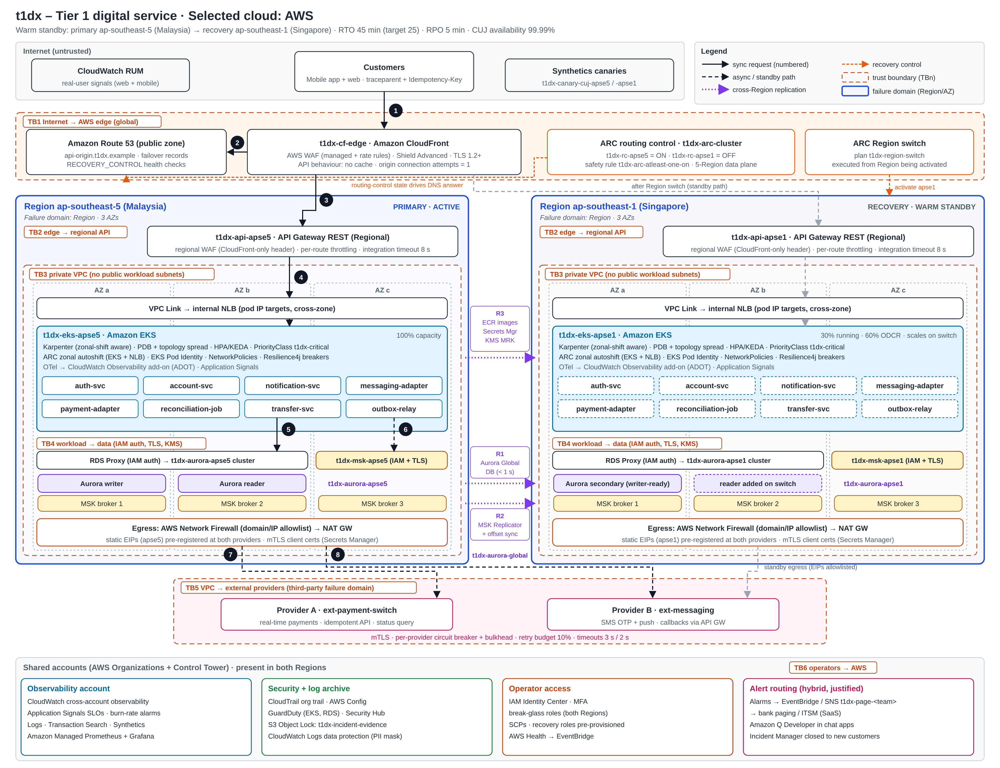

# 00. Architecture overview

> Selected cloud: AWS. Diagram: [`../diagrams/architecture.png`](../diagrams/architecture.png)

## 1. Shape of the system

| Layer | Primary `ap-southeast-5` | Recovery `ap-southeast-1` | Global |
|---|---|---|---|
| Edge | - | - | `t1dx-cf-edge` CloudFront + AWS WAF (CLOUDFRONT scope) + AWS Shield Advanced. Route 53 public zone. |
| Traffic control | `t1dx-rc-apse5` routing control = On | `t1dx-rc-apse1` routing control = Off | `t1dx-arc-cluster` (data plane spread across 5 Regions). `t1dx-region-switch` plan. |
| API | `t1dx-api-apse5` API Gateway REST (Regional) + regional WAF | `t1dx-api-apse1` (deployed, idle) | Same custom domain + ACM cert in each Region |
| Compute | `t1dx-eks-apse5`, 3 AZs, 100% capacity | `t1dx-eks-apse1`, 3 AZs, about 30% running, 60% reserved | ECR cross-Region replication |
| Streaming | `t1dx-msk-apse5`, 3 brokers / 3 AZs | `t1dx-msk-apse1`, full size | MSK Replicator `apse5 -> apse1`, identical topic names, offset sync |
| Data | `t1dx-aurora-apse5` writer + reader (Multi-AZ) | `t1dx-aurora-apse1` secondary, headless-ready (1 instance, scales on switch) | `t1dx-aurora-global` Aurora Global Database |
| Egress | AWS Network Firewall + NAT GW (static EIPs allowlisted at providers) | Same, with its own EIPs pre-registered | - |
| Secrets/keys | Secrets Manager, KMS | Replicated secrets, KMS multi-Region replica keys | - |

DR options considered

| Option | RTO | RPO | Cost | Risk | Verdict |
|---|---|---|---|---|---|
| Backup and restore | Hours | Hours | Low | - | Fails 45/5 |
| Pilot light (data only) | 45-90 min. EKS + MSK cold start and capacity risk. | Seconds | Low-medium | Capacity not guaranteed during a regional event | Too tight on RTO |
| Warm standby | 15-25 min target | Seconds (Aurora Global) | Medium (about 40-60% of primary) | Low | Chosen |
| Active-active | Minutes | Seconds | High (about 2x) | Write conflicts on a ledger, harder reconciliation, double change risk | Phase 2 option for read-only journeys (CUJ-02) |

## 2. Request flow (numbers match the diagram)

| Step | Hop | Sync/async | Behaviour |
|---|---|---|---|
| 1 | App -> `t1dx-cf-edge` | Sync | TLS 1.2+, WAF managed + rate-based rules, Shield Advanced. API behaviours are not cached. |
| 2 | CloudFront -> origin `api-origin.t1dx.example` | Sync | Route 53 failover record. The answer is driven by ARC routing-control health checks. Origin connection attempts = 1 (no edge retry). |
| 3 | `t1dx-api-apse5` | Sync | Request validation, per-route throttling, usage plans, regional WAF. Integration timeout 8 s. |
| 4 | API GW -> VPC Link -> internal NLB -> EKS pods | Sync | NLB targets pod IPs (AWS Load Balancer Controller, IP mode), cross-zone enabled |
| 5 | `transfer-svc` -> RDS Proxy -> `t1dx-aurora-apse5` | Sync | One transaction writes the transfer + idempotency key + outbox row |
| 6 | Outbox relay -> `t1dx-msk-apse5` `transfer.events.v1` | Async | MSK is not on the customer's synchronous path |
| 7 | `payment-adapter` -> Network Firewall -> `ext-payment-switch` | Async | mTLS, circuit breaker, retry budget |
| 8 | `notification-svc` -> `messaging-adapter` -> `ext-messaging` | Async | Push/SMS, deduplicated by notification ID |
| R1 | Aurora Global Database `apse5 -> apse1` | Async (storage level) | Typical lag < 1 s. Alarm on `AuroraGlobalDBRPOLag`. |
| R2 | MSK Replicator `apse5 -> apse1` | Async | Identical topic names. Consumer offsets synced. |
| R3 | ECR / Secrets Manager / KMS MRK | Async | Pre-replicated so nothing is created during DR |

## 3. Failure domains

| Domain | What fails together | Containment |
|---|---|---|
| Pod / node | One replica | >= 3 replicas, PDB, topology spread across AZs |
| AZ | Everything in 1 of 3 AZs | N+1 capacity (each AZ <= 50% of peak), ARC zonal autoshift (EKS, NLB), Aurora Multi-AZ, MSK 3-AZ |
| Region | Whole `apse5` stack | Warm standby `apse1` + Region switch |
| Global edge | CloudFront / Route 53 (rare, global) | No in-scenario alternative. Mitigated by AWS's global design. Documented as residual risk. |
| External provider | `ext-payment-switch` or `ext-messaging` | Circuit breaker, pending state, queue + controlled replay, separate SLO |
| Deployment / change | Bad release | Progressive delivery (canary 5% -> 25% -> 100%) gated on burn rate. Most real incidents are changes. |

## 4. Security controls by trust boundary

| Boundary | Controls |
|---|---|
| TB1 Internet -> AWS edge | CloudFront TLS 1.2+ (TLS 1.3 preferred), AWS WAF (managed rules, bot control, rate-based rules per IP/session), Shield Advanced + Shield Response Team, geo rules where policy allows |
| TB2 Edge -> regional API | API Gateway accepts only CloudFront traffic (secret origin header checked by a regional WAF rule). Request validation, JWT validation, throttling. |
| TB3 API -> VPC (private) | VPC Link to an internal NLB. No public subnets for workloads. Security groups. EKS private endpoint. |
| TB4 Workload -> data | EKS Pod Identity (least-privilege IAM per service). Security groups for pods. Kubernetes NetworkPolicies. RDS Proxy with IAM auth. MSK IAM auth + TLS. KMS encryption at rest (multi-Region keys). |
| TB5 VPC -> external providers | Egress only through AWS Network Firewall (domain/IP allowlist). Static NAT EIPs registered with each provider. mTLS client certs in Secrets Manager (replicated). No inbound path except signed provider callbacks through API Gateway. |
| TB6 Operators -> AWS | IAM Identity Center, break-glass roles with MFA, SCPs (deny Region/service sprawl). Recovery roles pre-provisioned in both Regions. CloudTrail org trail. |
| Detective | GuardDuty (incl. EKS + RDS protection), Security Hub, AWS Config conformance packs, CloudWatch Logs data protection (mask account / IC numbers) |
| Evidence | `t1dx-incident-evidence` S3 bucket with Object Lock (compliance mode) in the log-archive account |

## 5. Global dependencies and the control-plane rule

> Static stability rule. During an incident we only change the state of resources that already exist. Nothing new is created, and recovery actions use data-plane APIs only.

| Dependency | Plane | How we stay safe |
|---|---|---|
| ARC routing control state change | Data plane (cluster endpoints in 5 Regions) | Use CLI/SDK against the cluster endpoints. Try another endpoint if one fails. Do not use the console for routing control changes during an event. |
| Route 53 DNS answers + health checks | Data plane (global) | Pre-created records and health checks |
| CloudFront config change | Control plane (`us-east-1`) | Not needed for failover. The origin hostname stays the same. |
| ARC Region switch execution | Runs from the Region being activated | Plan lives in both Regions. Execute it from `apse1`. |
| IAM | Global control plane, regional data plane | Roles exist ahead of time. No IAM changes during DR. |

## 6. Cost (order of magnitude, to verify in AWS Pricing Calculator)

| Item | Indicative | Note |
|---|---|---|
| Warm standby `apse1` (EKS 30% running, MSK full, Aurora secondary, NAT/NFW, API GW idle) | About 40-60% of primary run cost | MSK at full size is the biggest choice. It avoids slow broker scaling during DR. |
| Capacity reservations (ODCR) for 60% DR baseline | Billed whether used or not | Cost of a guaranteed RTO. Review quarterly. |
| ARC routing control cluster | US$2.50/hour (about US$1,825/month) | One cluster can be shared across accounts |
| ARC Region switch plan | US$70/plan/month | - |
| Zonal shift / autoshift | No extra charge | - |
| Shield Advanced | US$3,000/month per organisation + data transfer | Includes DDoS cost protection and SRT access |
| Inter-Region replication (Aurora, MSK, ECR) | Per-GB data transfer | Scales with write volume |
| Observability | Typically the 2nd-largest ops line | Controlled via log classes, retention tiers and trace sampling ([03 section 7](03-observability-architecture.md#7-retention-and-cost)) |

## 7. Ownership of this architecture

| Component | Owner |
|---|---|
| Edge (CloudFront, WAF, Shield), DNS, ARC | Platform team (Edge & Network) |
| EKS clusters, Karpenter, add-ons | Platform team (Compute) |
| Aurora, MSK, RDS Proxy | Platform team (Data platform) |
| Services on EKS | Owning product team (see [01 section 6](01-reliability-model.md#6-ownership-raci)) |
| SLO framework, alert routing standards, incident process, game days | SRE |
| Provider contracts and SLAs | Vendor management + product owner. SRE supplies the evidence. |
