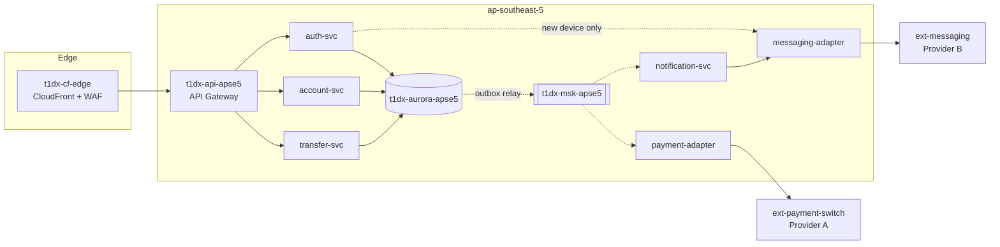

# 01. Service reliability model

> Task 1 (20%). Selected cloud: AWS. Covers the critical user journeys, dependencies, failure modes, SLIs/SLOs (summary - full spec in [02](02-sli-slo-specification.md)), error budgets and ownership.

## 1. Critical user journeys (CUJs)

| ID | Journey | Customer sees | Business impact if broken | Tier | Path type |
|---|---|---|---|---|---|
| CUJ-01 | Login (device-bound. SMS OTP for new devices) | "I can get in" | No access to any service. Call-centre surge | Critical | Sync |
| CUJ-02 | View balance and recent transactions | "I can see my money" | Trust, call volume | Critical | Sync (read) |
| CUJ-03 | Fund transfer / payment | "My money moved or I know it is pending" | Direct financial and regulatory impact | Critical | Sync accept + async complete |
| CUJ-04 | Transfer notification (push/SMS) | "I got told it happened" | Fraud detection by the customer, complaints | High | Async |

Out of scope for 99.99%: statements export, profile edits, marketing content. These are shed first under load (see [04 section 7](04-resilience-architecture.md#7-load-shedding)).

## 2. Dependency map per journey

| CUJ | Synchronous chain (customer waits) | Async chain (customer does not wait) | Hard dependencies | Soft dependencies (degradable) |
|---|---|---|---|---|
| CUJ-01 | CloudFront -> API GW -> `auth-svc` -> Aurora | - | CloudFront, API GW, EKS, Aurora | `ext-messaging` (new-device OTP only) |
| CUJ-02 | CloudFront -> API GW -> `account-svc` -> Aurora reader | - | CloudFront, API GW, EKS, Aurora reader | Transaction enrichment (merchant names) |
| CUJ-03 | CloudFront -> API GW -> `transfer-svc` -> Aurora writer (transfer + idempotency + outbox) | outbox -> MSK -> `payment-adapter` -> `ext-payment-switch` -> status update | CloudFront, API GW, EKS, Aurora writer | MSK, `ext-payment-switch` (for acceptance) |
| CUJ-04 | - | MSK -> `notification-svc` -> `messaging-adapter` -> `ext-messaging` | MSK, `ext-messaging` | - |

> MSK and both providers are kept off the synchronous path of every critical journey. This is why the journey target can be set higher than the MSK SLA (99.9%) or either provider's SLA.

## 3. Failure modes (FMEA)

Scoring: Severity (S), Likelihood (L) and Detectability (D), each 1-5. D = 5 means hard to detect. RPN = S x L x D. Current-state likelihood comes from the scenario: two retry-storm incidents and DR never tested.

| # | Component | Failure mode | Customer effect | Current detection | S | L | D | RPN | Mitigation (doc) |
|---|---|---|---|---|---|---|---|---|---|
| F1 | All service hops | Retry storm: layered retries amplify a brief slowdown | Regional outage (has happened x2) | CPU/5xx alerts, late | 5 | 4 | 3 | 60 | Single-layer retries, 10% retry budget, jitter, circuit breakers, shedding ([04](04-resilience-architecture.md)) |
| F2 | Region `apse5` | Regional impairment (multi-service) | All CUJs down | Unclear. No authority | 5 | 1 | 3 | 15 | Warm standby + Region switch ([05](05-dr-runbook.md)) |
| F3 | DR capability | DR fails when invoked (missing IAM, stale config, provider allowlist, capacity) | Outage extends past RTO | None - never tested | 5 | 4 | 5 | 100 | Plan evaluation, game days L0-L3 ([06](06-game-day-plan.md)) |
| F4 | Detection | Customer impact not detected (alert noise) | Longer outages | Customer complaints | 4 | 4 | 4 | 64 | Burn-rate paging, synthetics, business signals ([03](03-observability-architecture.md)) |
| F5 | `ext-payment-switch` | Slow / timeouts | Transfers stuck. Threads exhausted -> wider outage | Partial | 4 | 3 | 3 | 36 | Timeouts 3 s, circuit breaker, bulkhead, pending state |
| F6 | `ext-payment-switch` | Ambiguous result (timeout after the provider processed it) | Double payment if retried naively | None | 5 | 3 | 4 | 60 | Provider idempotency key = our `transfer_id`. Status query before any retry. Reconciliation job |
| F7 | `ext-messaging` | Outage | No OTP for new devices. No notifications | Partial | 3 | 3 | 3 | 27 | Circuit breaker. In-app inbox fallback. Queue + replay. Separate SLO |
| F8 | Aurora writer | AZ / instance failure | Writes fail ~30-60 s | CloudWatch | 4 | 2 | 2 | 16 | Multi-AZ, RDS Proxy (pins connections through failover), retry only on failover error codes |
| F9 | Aurora | Connection storm after failover / deploy | Login + transfer errors | Late | 4 | 3 | 3 | 36 | RDS Proxy, pool limits, startup jitter |
| F10 | MSK | Broker loss / partition leader moves | Async delay | Lag metrics | 2 | 3 | 2 | 12 | RF 3, `min.insync.replicas` 2, outbox buffers |
| F11 | MSK consumers | Poison message blocks a partition | Notifications / completions stall | Lag, late | 3 | 3 | 3 | 27 | Retry topics + DLQ, poison detection ([04 section 6](04-resilience-architecture.md#6-backpressure-and-queue-recovery-msk)) |
| F12 | EKS | AZ impairment (grey failure) | Partial errors / latency | Hard (looks "healthy") | 4 | 2 | 4 | 32 | Zonal autoshift, per-AZ SLIs, FIS AZ test |
| F13 | EKS | Bad deployment | Any CUJ | Late | 4 | 4 | 2 | 32 | Canary rollout gated on burn rate. Automatic rollback |
| F14 | API Gateway | Account/route throttle hit at peak | 429s to customers | None | 3 | 2 | 3 | 18 | Quota raised in both Regions. Per-route limits. Quota alarms |
| F15 | CloudFront/WAF | Bad WAF rule blocks real users | Login fails | Late | 4 | 2 | 3 | 24 | WAF rules in COUNT mode first. WAF metrics on the dashboard |
| F16 | Config / secrets | Expired certificate (mTLS to a provider) | Transfers fail | None | 4 | 2 | 4 | 32 | ACM / Secrets Manager rotation, expiry alarms at 30/14/7 days |

Top 5 by RPN (drive the [roadmap](08-roadmap-90-day.md)): F3 DR untested (100), F4 detection (64), F1 retry storm (60), F6 ambiguous payment (60), F5/F9 (36).

## 4. SLOs and error budgets (summary)

Full definitions, measurement points and burn-rate alerts are in [02](02-sli-slo-specification.md).

| CUJ | SLI | SLO (30-day rolling) | Error budget / 30 days |
|---|---|---|---|
| CUJ-01 | Successful logins / valid login attempts | 99.99% | 4.32 min or 1 in 10,000 |
| CUJ-01 | Logins < 1.5 s | 99.0% | 1% slow |
| CUJ-02 | Successful balance reads | 99.99% | 4.32 min |
| CUJ-02 | Balance reads < 800 ms | 99.0% | 1% slow |
| CUJ-03a | Transfer accepted (durable record + truthful status returned) | 99.99% | 4.32 min |
| CUJ-03a | Accepted < 1 s | 99.0% | 1% slow |
| CUJ-03b | Transfer completed (final status) within 30 s | 99.9% | 43.2 min |
| CUJ-04 | Notification delivered to provider within 60 s of completion | 99.9% | 43.2 min |
| Data | Aurora `AuroraGlobalDBRPOLag` < 5 min | 100% of minutes (RPO objective) | 0 - any breach is a P2 |

## 5. Critical data set (RPO scope)

The constraint says "RPO 5 minutes for the stated critical data set". This is the statement:

| In scope (RPO <= 5 min) | Store | Why |
|---|---|---|
| Ledger entries, account balances | `t1dx-aurora-global` | Money |
| Transfers and their status | `t1dx-aurora-global` | Money, regulatory |
| Idempotency keys (72 h TTL) | `t1dx-aurora-global` | Prevents double execution after failover |
| Transactional outbox | `t1dx-aurora-global` | Source of truth for events. Rebuilds Kafka after DR. |
| Customer profile, device bindings, credentials | `t1dx-aurora-global` | Login |
| Audit events | `t1dx-aurora-global` -> S3 Object Lock | Regulatory |

| Out of scope (rebuildable or acceptable loss) | Why |
|---|---|
| Kafka topic contents | Re-derived from the outbox. Replicated by MSK Replicator as best effort. |
| Sessions / tokens | Customers re-login (short-lived tokens) |
| Caches, read models, analytics | Rebuildable |
| Notification history | Low value. Duplicates are acceptable. |
| Observability data | Separate retention controls |

## 6. Ownership (RACI)

R = Responsible, A = Accountable, C = Consulted, I = Informed.

| Activity | Product team (service owner) | Platform team | SRE | Vendor mgmt | Risk/Compliance |
|---|---|---|---|---|---|
| Define CUJ SLOs | R | C | A (framework) / C | I | C |
| Meet service SLO, fix own reliability bugs | A/R | C | C | - | I |
| On-call for own services | A/R | - | C (coach, escalation) | - | - |
| Platform SLOs (EKS, MSK, Aurora, edge) | C | A/R | C | - | - |
| Alerting standards, burn-rate rules, dashboards template | C | C | A/R | - | - |
| Incident command (P1/2) | R (tech lead) | R | A (IC rotation) | R (provider liaison) | R (regulator comms) |
| DR runbook + Region switch plan | C | R | A | C | I |
| Game days | R (participate) | R | A (design, run) | C | I |
| Provider SLAs and escalation contacts | C | - | C (evidence) | A/R | C |
| Error budget policy enforcement | R | R | A (report) / Head of Eng (decide) | - | I |
| 90-day reliability backlog | R (own items) | R (own items) | A (prioritise) | - | I |

The team that ships a service owns its reliability. SRE owns the SLO framework and tooling, and runs incident command, but does not take over other teams' backlogs or pagers. Rules to stop SRE becoming a dumping ground are in [08 section 5](08-roadmap-90-day.md#5-governance-to-keep-sre-out-of-the-dumping-ground).

## 7. Provider-native evidence

| Claim | AWS evidence source |
|---|---|
| Journey success / latency | API Gateway per-method `Count`, `5XXError`, `Latency` (detailed metrics). CloudFront `5xxErrorRate` + real-time logs. CloudWatch Application Signals SLOs |
| Synthetic availability (outside-in) | CloudWatch Synthetics canaries in both Regions |
| Dependency health | Application Signals service map (OpenTelemetry via ADOT / CloudWatch Observability EKS add-on) |
| Data protection (RPO) | `AuroraGlobalDBRPOLag` (CloudWatch), MSK Replicator `ReplicationLatency` / `MessageLag` |
| DR readiness | ARC Region switch plan evaluation (every 30 min), game-day results |
| AWS-side events | AWS Health events via EventBridge (both Regions) |
| Change correlation | CloudTrail, EKS deployment events, release annotations on dashboards |
