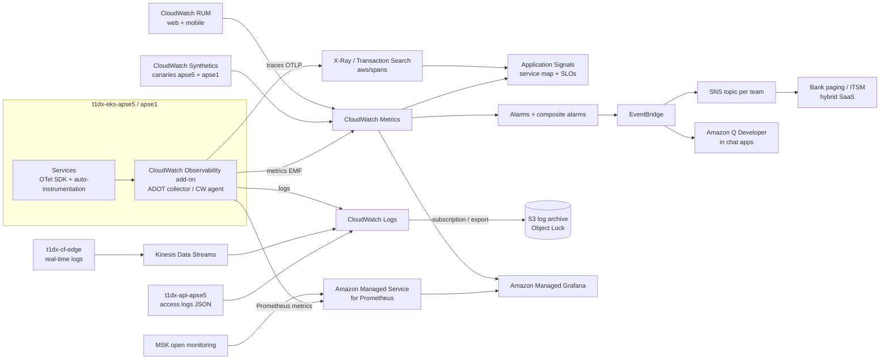

# 03. Observability architecture

> Task 2 (15%). Selected cloud: AWS. Problem from the scenario: "many alerts but slow detection of customer-impacting failures".

## 1. Design goals

| Goal | Measure | Target (Day 90) |
|---|---|---|
| Detect customer impact fast | MTTD for P1/2 (from impact start to page) | <= 5 min (burn-rate fast alert ~ 1-2 min) |
| Pages are actionable | % of pages that needed human action | >= 80% (current: assume < 30%) |
| Follow any request end to end | % of CUJ requests with a complete trace (edge -> DB -> Kafka -> provider) | >= 95% |
| Monitoring keeps working when `apse5` is down | Canaries and alarms in `apse1` keep working when `apse5` is down | Proven in game day L2 |
| Cost under control | Observability spend as % of run cost | Tracked monthly, budget alarm |

## 2. Architecture

Account layout: every workload account (prod `apse5`, DR-prod `apse1`) shares telemetry with an observability monitoring account through CloudWatch cross-account observability (OAM links). The monitoring account keeps its alarms and dashboards in both Regions, so losing `apse5` does not blind us.

Why mostly CloudWatch, plus Prometheus:

| Signal | Tool | Trade-off |
|---|---|---|
| CUJ SLIs, alarms, synthetics, RUM, SLOs | CloudWatch + Application Signals | Native and multi-Region. Cost grows with custom metrics and logs volume. |
| High-cardinality K8s, Kafka, JVM metrics | Amazon Managed Service for Prometheus + Managed Grafana | PromQL and community dashboards (MSK open monitoring, kube-state-metrics). A second system to run. |
| Traces | X-Ray + CloudWatch Transaction Search (spans stored in `aws/spans` log group) | 100% span capture is possible, with indexing sampled to control cost. X-Ray SDKs are giving way to OpenTelemetry, so we instrument with OTel only. |

## 3. Telemetry standards (mandatory for every service)

| Area | Standard |
|---|---|
| Instrumentation | OpenTelemetry SDK / auto-instrumentation (Java agent). No vendor-specific SDKs. |
| Resource attributes | `service.name`, `service.version`, `deployment.environment` (`prod`/`dr-prod`), `cloud.region`, `cloud.availability_zone`, `k8s.namespace.name`, `owner.team` |
| Business attributes | `cuj` (`CUJ-01`..`CUJ-04`), `transfer.id` (on CUJ-03 spans), `customer.segment` (retail/SME). Never account numbers, IC numbers, OTPs or names. |
| Logs | JSON, one event per line. Fields: `timestamp` (UTC, ISO 8601), `level`, `service.name`, `trace_id`, `span_id`, `cuj`, `event`, `outcome`, `duration_ms`, `error.type` |
| Metrics | RED per endpoint (rate, errors, duration) as EMF. USE for infra via Container Insights. Histogram buckets aligned to SLO thresholds (800 ms, 1 s, 1.5 s). |
| Cardinality | No user/transfer IDs as metric dimensions (they go in traces and logs). Max 3 custom dimensions per metric. |
| PII | CloudWatch Logs data protection policy on all app log groups: mask `.*AccountNumber`, Malaysian IC number pattern, card numbers. OTP values never logged (code review + lint rule). |
| Clock | Chrony / Amazon Time Sync. Timestamps in UTC. Dashboards display MYT. |

## 4. Correlation

| Hop | How the trace context travels |
|---|---|
| App -> CloudFront -> API GW | App generates `traceparent` (W3C) + `X-Request-Id`. CloudFront forwards both headers (origin request policy). |
| API GW -> EKS | API GW access log captures `$context.requestId` and the incoming `traceparent`. The service continues the trace. |
| Service -> Aurora | DB spans via the OTel JDBC instrumentation. `application_name` tag set for slow-query correlation in Performance Insights / Database Insights. |
| Service -> MSK | `traceparent` written into Kafka record headers by the outbox relay. Consumers start a linked span. This is the usual gap that breaks async tracing. |
| Adapter -> providers | Our `transfer_id` is sent as the provider's idempotency/reference key, so provider tickets can be matched to our traces. |
| Logs and traces | `trace_id` in every log line. CloudWatch Logs Insights and Application Signals jump from span to logs. |
| Deploys and signals | Every deploy publishes an annotation (EventBridge event -> dashboard annotation). CloudTrail records infra changes. |

## 5. Service maps

- CloudWatch Application Signals builds the service map automatically from OTel spans: `auth-svc`, `account-svc`, `transfer-svc`, `payment-adapter`, `notification-svc`, `messaging-adapter`, plus their AWS dependencies (Aurora, MSK) and external endpoints (`ext-payment-switch`, `ext-messaging`, shown as remote services).
- Per-dependency SLIs (availability, latency) for each edge on the map. These feed circuit-breaker tuning ([04](04-resilience-architecture.md)).
- Map is reviewed in the Production Readiness Review. A service missing from the map = not instrumented = PRR fail.

## 6. Synthetic checks and business signals

Synthetics (CloudWatch Synthetics canaries)

| Canary | Runs from | Every | Checks | Notes |
|---|---|---|---|---|
| `t1dx-canary-cuj-apse5` | `ap-southeast-5` | 1 min | Login (test customer), balance, transfer of RM 0.01 between two synthetic accounts | Synthetic accounts are flagged and excluded from finance reports |
| `t1dx-canary-cuj-apse1` | `ap-southeast-1` | 1 min | Same flows through the public edge | Survives an `apse5` outage. It is the outside-in view during DR. |
| `t1dx-canary-dr-direct` | `ap-southeast-1` | 5 min | Hits `t1dx-api-apse1` directly (bypasses routing) with read-only calls | Proves the standby works before we fail over |
| `t1dx-canary-providers` | Both Regions | 1 min | Provider health/status endpoints via each Region's egress EIPs | Detects provider allowlist drift for the DR egress IPs |

Business signals (often the first sign of a silent failure)

| Signal | Source | Alert |
|---|---|---|
| Transfers accepted per minute | `transfer-svc` EMF | CloudWatch anomaly detection band (seasonal, weekly), sustained 10 min below band -> page |
| Transfer completion rate (completed / accepted, 5 min) | EMF | < 98% for 10 min -> page `payments` team |
| Login success rate | Access logs | Drop below band -> page |
| OTP delivery rate (provider callbacks / sent) | `messaging-adapter` | < 95% for 10 min -> ticket + provider liaison |
| Payment provider rejection codes mix | `payment-adapter` | New dominant code -> ticket |
| Outbox backlog (unpublished rows, age of oldest) | Aurora query exported as metric | Oldest > 60 s -> page |

## 7. Retention and cost

| Data | Hot store / retention | Archive | Rationale / cost control |
|---|---|---|---|
| CloudWatch metrics | 15 months (auto-rollup) | - | Native |
| AMP metrics | 150 days (default) | - | Capacity trend analysis |
| App logs (debug/info) | CloudWatch Logs Infrequent Access class, 14 days | - | Lower ingestion cost. Logs Insights still works |
| App logs (warn/error), API GW access logs | CloudWatch Logs Standard, 30 days | S3 via subscription/export, 1 year | Incident investigation |
| Audit/security logs (CloudTrail org trail, auth events, admin actions, WAF logs) | 90 days in CloudWatch | S3 Object Lock (compliance) 7 years in the log-archive account, then Glacier Deep Archive tiering | Assumed bank record retention. Confirm with Compliance. |
| Traces / spans | 30 days (`aws/spans`, X-Ray) | - | 100% spans for CUJ-03, 10% head sampling elsewhere, errors and slow spans always kept (tail sampling in ADOT) |
| Synthetics artefacts (screenshots, HAR) | S3, 30 days | - | Lifecycle rule |
| Incident evidence | `t1dx-incident-evidence` (Object Lock) | 7 years | See [07 section 6](07-incident-command.md#6-evidence) |

## 8. Alert routing

Rule: page on symptoms, ticket on causes.

| Class | Examples | Route | Channel |
|---|---|---|---|
| Page | CUJ fast/slow burn (composite), synthetic CUJ failure (2 consecutive runs) from either Region, business-signal anomaly, `AuroraGlobalDBRPOLag` > 180 s, outbox age > 60 s | Owning team's primary on-call. IC auto-paged for 2+ CUJs. | Paging tool (phone/push) + Teams/Slack via Amazon Q Developer in chat apps |
| Ticket | Pod restarts, node CPU, single-broker issue, budget-leak (3 d), cert expiry 30/14 days, quota at 80% | Team backlog (Jira) | ITSM ticket, no page |
| Dashboard only | Resource utilisation, cache hit ratio | - | Grafana / CloudWatch |
| Delete | Alerts nobody acted on in 30 days | - | Monthly alert review |

Routing mechanics

1. Every alarm carries tags `owner_team`, `cuj` and `route` (`page`/`ticket`). Terraform uses the same values to choose the alarm action, so tags and routing cannot drift apart ([`slo_burn_rate_alarms.tf`](../terraform/observability/slo_burn_rate_alarms.tf)).
2. `route=page` -> alarm action SNS topic `t1dx-page-<team>` -> the paging tool's AWS integration endpoint. `route=ticket` -> SNS `t1dx-ticket-<team>` -> ITSM. A separate EventBridge rule on alarm state changes forwards every page to the team's chat channel (Amazon Q Developer in chat apps).
3. The same alarms exist in both Regions (the DR alarm set is armed but routed with lower urgency until a Region switch).
4. CloudFront metrics are only in `us-east-1`, so CloudFront alarms live there and route through the same EventBridge -> SNS pattern.
5. Dead man's switch: a heartbeat alarm on canary `SuccessPercent` with `treat_missing_data = breaching`. If telemetry itself stops, we get paged.
6. AWS Health: `aws.health` EventBridge rules in both Regions for EKS, RDS, MSK, API Gateway and CloudFront events -> IC channel.

The paging tool is the one hybrid piece. AWS Systems Manager Incident Manager stopped accepting new customers on 7 Nov 2025. We use the bank's existing paging/ITSM SaaS (AWS documents migration paths to PagerDuty and Jira Service Management). Fallback if it fails: SNS SMS/email to the on-call group list, tested quarterly.

## 9. Alert hygiene programme (Day 1-30)

| Step | Action |
|---|---|
| 1 | Export 90 days of alarm history (`DescribeAlarmHistory`) + paging tool stats |
| 2 | Classify every alert: led to action / no action / duplicate |
| 3 | Delete or downgrade to ticket anything with < 20% action rate |
| 4 | Replace with CUJ burn-rate pages (8 composite alarms across CUJ-01..04) |
| 5 | Track weekly: pages per on-call shift (target <= 2), % actionable (target >= 80%) |

## 10. Security, cost, ownership

| | |
|---|---|
| Security | Telemetry is encrypted with KMS. Logs data protection masks PII. Monitoring account access is read-only via IAM Identity Center. Evidence lives in a separate log-archive account. |
| Cost | Infrequent Access log class, sampling, 30-day hot retention, metric cardinality rules, monthly cost review of the top 10 log groups |
| Ownership | SRE owns standards, the shared collector config, alert routing and dashboards templates. Teams own their instrumentation and their alerts. Platform owns the ADOT/agent add-on. |
| Validation | FIS fault injection must trigger the expected page in <= 2 min. The `apse1` canaries must keep reporting during the L2 game day. |
