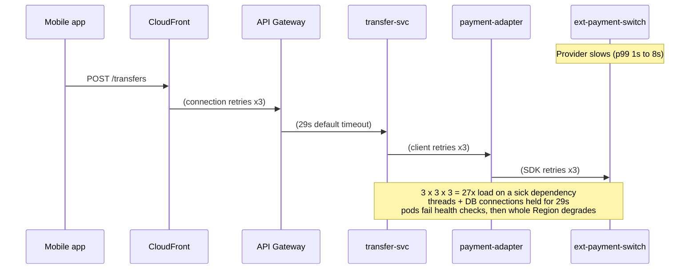

# 04. Resilience architecture

> Task 3 (20%). Selected cloud: AWS. Problem from the scenario: "Retry storms have caused two regional incidents". Config: [`../config/resilience/`](../config/resilience/), EKS manifests: [`../k8s/`](../k8s/).

## 1. How the retry storms happened

| Cause | Fix | Section |
|---|---|---|
| Every layer retries | Retry at one layer only: the layer closest to the dependency | section 3 |
| Retries unbounded under failure | Retry budget (<= 10% extra load) + exponential backoff with full jitter | section 3 |
| Timeouts longer than the caller's patience | Deadline budget that shrinks with each hop | section 2 |
| Retrying non-idempotent calls | Idempotency keys end to end | section 4 |
| Calling a dependency that is clearly down | Circuit breakers + bulkheads per dependency | section 5 |
| Accepting more work than we can finish | Backpressure + load shedding by priority | section 6, section 7 |
| Synchronous coupling to MSK and providers | Outbox + async completion | section 6 |

## 2. Timeouts - deadline budget for `POST /transfers` (CUJ-03)

Each hop's timeout must be shorter than its caller's. The remaining deadline travels as a header (`x-deadline-ms`). A service that receives a request with < 100 ms left rejects it immediately instead of doing work nobody will wait for.

| Hop | Setting (AWS-native where it exists) | Value | Reason |
|---|---|---|---|
| Mobile app | HTTP client total timeout | 10 s | After 10 s the app shows "checking status" and polls `GET /transfers/{id}`. It does not blind-retry. |
| CloudFront -> origin | Origin connection attempts | 1 (default 3) | Removes the hidden edge retry layer |
| CloudFront -> origin | Connection timeout / response timeout | 3 s / 9 s | Response timeout > API GW integration timeout, so API GW answers first with a clean 504 |
| API Gateway -> VPC Link | Integration timeout | 8 s (default 29 s) | Stops holding connections for 29 s |
| `transfer-svc` request | Server deadline | 7 s | - |
| `transfer-svc` -> RDS Proxy -> Aurora | Connection acquire / `statement_timeout` | 500 ms / 2 s | Fail fast on DB pressure |
| Outbox relay -> MSK | `delivery.timeout.ms` / `request.timeout.ms` | 30 s / 5 s | Async. Not on the customer path |
| `payment-adapter` -> `ext-payment-switch` | Connect / response | 500 ms / 3 s | Assumed provider p99 ~ 1.2 s. 3 s ~ 2.5x p99 |
| `messaging-adapter` -> `ext-messaging` | Connect / response | 500 ms / 2 s | - |
| `auth-svc` -> `messaging-adapter` (OTP) | Response | 2.5 s | - |

Values live in [`config/resilience/timeout-budget.yaml`](../config/resilience/timeout-budget.yaml). Each is reviewed against observed p99 (Application Signals) every quarter.

## 3. Retries and retry budgets

Rules

1. One retrying layer per dependency. `payment-adapter` retries the provider. `transfer-svc` does not retry `payment-adapter`. API Gateway and CloudFront do not retry.
2. Retry only retryable errors: connection reset, 503 with `Retry-After`, Aurora failover error codes. Never retry 4xx and never retry a timeout to a non-idempotent endpoint (see section 4).
3. Max 2 attempts (1 retry). Exponential backoff with full jitter: `sleep = random(0, min(cap, base x 2^attempt))`, with base 100 ms and cap 1 s.
4. Retry budget per client: retries may add at most 10% to the request rate. Implemented as a token bucket: each success adds 0.1 tokens (cap 10), each retry costs 1 token and with no tokens there is no retry. Under a total outage, extra load is capped at +10% instead of +200%.
5. AWS SDK calls (Secrets Manager, S3, STS) use the SDK `standard` retry mode. Its retry quota is already a token bucket. High-volume paths use `adaptive` mode for client-side rate limiting.
6. Clients honour `Retry-After`. The mobile app retries once at most, with jitter, using the same `Idempotency-Key`.

Retry-amplification ceiling after the fix: app 1.1x x edge 1x x API 1x x service 1x x adapter 1.1x ~ 1.21x worst case (before: 27x).

## 4. Idempotency

| Layer | Mechanism |
|---|---|
| API contract | `POST /transfers` requires an `Idempotency-Key` header (UUIDv4 generated by the app per user intent). Missing key -> 400. |
| `transfer-svc` | In one Aurora transaction: insert into `idempotency_keys` (`key`, `customer_id`, `request_hash`, `response`, `expires_at`). Insert into `transfers` (status `ACCEPTED`). Insert into `outbox`. A unique constraint on (`customer_id`, `key`) makes duplicates return the stored response. Same key with a different body -> 422. |
| TTL | 72 h (covers app retries, a DR event and reconciliation). Expired by a scheduled cleanup job. |
| Provider call | `payment-adapter` sends `transfer_id` as the provider's idempotency/end-to-end reference. After an ambiguous timeout it queries the provider status API before any retry. |
| Consumers | Every Kafka event has `event_id` (= outbox row ID). Consumers keep a processed-ID table (or an idempotent upsert keyed by `event_id`) -> at-least-once delivery, effectively-once processing. |
| DR | Idempotency keys are in the critical data set (replicated by Aurora Global DB), so a retry after failover still dedupes. |

The keys are kept in Aurora because the key, the business write and the outbox then commit in one transaction. There is no window where the transfer exists without its key.

## 5. Circuit breakers and bulkheads

Implemented with Resilience4j in the shared Java client library (services are Spring Boot on EKS). Config: [`config/resilience/resilience4j-transfer.yaml`](../config/resilience/resilience4j-transfer.yaml).

| Dependency | Breaker opens when | Open for | Half-open probe | Fallback when open |
|---|---|---|---|---|
| `ext-payment-switch` | >= 50% failures or >= 50% calls slower than 2 s, over the last 100 calls (min 20) | 30 s | 5 calls | Transfer stays `ACCEPTED`/`PENDING`. Event goes to `transfer.retry.v1` with delay. Customer told "processing". |
| `ext-messaging` (OTP) | Same thresholds, 1.5 s slow-call | 30 s | 5 | New-device login: offer in-app approval on an existing bound device or "try again in a few minutes" |
| `ext-messaging` (notifications) | Same | 60 s | 5 | Queue in `notification.requests.v1`. In-app inbox shows the notification. |
| Aurora (via RDS Proxy) | Connection-acquire failures > 50% over 10 s | 5 s | 3 | Read paths: serve from reader / degrade non-critical fields. Write paths: 503 + `Retry-After: 2`. |

Bulkheads: a separate thread pool / semaphore per dependency, sized by Little's Law. Example: provider at a peak of 150 TPS x 1.2 s p99 ~ 180 concurrent -> bulkhead 200 per Region, spread across pods. A slow provider can then only exhaust its own pool, not the service's request threads.

Grey failures: Application Signals dependency latency per AZ. If one AZ's calls are slow, ARC zonal shift moves traffic away from that AZ (section 8). The breaker does not open for an AZ-local problem.

## 6. Backpressure and queue recovery (MSK)

Topics: `transfer.events.v1` (key = `transfer_id`), `transfer.retry.v1`, `transfer.dlq.v1`, `notification.requests.v1`. RF 3, `min.insync.replicas` = 2, producer `acks=all` + `enable.idempotence=true`.

| Mechanism | Design |
|---|---|
| Transactional outbox | `transfer-svc` never writes to Kafka directly. The outbox relay polls `outbox` (or uses logical replication) and publishes, marking rows as published. If MSK is down, transfers are still accepted. Backlog builds in Aurora and drains later. |
| Consumer backpressure | `max.poll.records` = 100, bounded in-memory queue. When the downstream breaker is open, the consumer pauses partitions instead of spinning. |
| Scaling | KEDA scales consumers on MSK consumer lag. Max replicas = partition count (parallelism ceiling). Partitions sized for 2x peak. |
| Retry topics | Failed processing -> `transfer.retry.v1` with a `not_before` header. Retry consumer waits 5 s -> 30 s -> 5 min (3 tiers), then -> DLQ. |
| Poison messages | Deserialisation or validation failure -> straight to `transfer.dlq.v1` with error metadata. Never block a partition. |
| DLQ handling | DLQ depth > 0 -> ticket. > 50 -> page. A replay tool re-publishes selected messages after a fix, rate-limited (e.g. 50 msg/s), so recovery does not become the next incident. |
| Recovery after an outage | Drain in priority order: completions (`transfer.events.v1`) before notifications. Throttle outbox relay and replay to <= 50% of the provider's agreed TPS. Watch provider error rate and stop if it rises. |
| Ordering | Per-`transfer_id` ordering via key. Consumers handle out-of-order status with state-machine checks (no `COMPLETED -> PENDING`). |

## 7. Load shedding

Shedding classes (highest first): C0 `POST /transfers`, login, C1 balance / recent transactions, C2 transaction history search, statements, profile edits, C3 marketing, recommendations.

| Layer | Control | Behaviour |
|---|---|---|
| Edge | AWS WAF rate-based rules (per IP, per session token) on `t1dx-cf-edge` | Blocks abusive clients and bots before they reach the Region |
| Edge | Shield Advanced | DDoS absorption + cost protection |
| API | API Gateway per-route throttling (stage/method settings) and usage plans per client app version | Returns 429 above the configured rate. C2/C3 routes get lower limits. |
| Service | Adaptive concurrency limit per pod (in-flight requests). When the limit is hit, shed C3 -> C2 -> C1 first and keep C0 | 503 + `Retry-After`. Cheap rejection (< 1 ms). |
| Service | Deadline check (section 2) | Drops requests whose caller has already given up |
| Feature flags | "Degraded mode" flags: hide C2/C3 features in the app, disable enrichment | Reduces load during incidents. Pre-tested in game days. |
| Kubernetes | `PriorityClass` (`t1dx-critical` for C0 workloads) | C0 pods keep their nodes under pressure. C3 pods are evicted first. |

## 8. Capacity strategy

| Area | Strategy |
|---|---|
| AZ loss | 3 AZs. Each AZ sized so any 2 AZs carry 100% of peak (N+1 = 150% provisioned). Topology spread constraints (`maxSkew: 1`) + PDB (`minAvailable: 66%`) - see [`k8s/transfer-svc-resilience.yaml`](../k8s/transfer-svc-resilience.yaml). |
| AZ grey failure | ARC zonal autoshift enabled for `t1dx-eks-apse5` and the internal NLB. Karpenter is zonal-shift aware, so it does not launch nodes into the shifted AZ. Zonal shift capacity assumes the N+1 sizing above. AWS runs practice runs. We approve the practice window. |
| Node scaling | Karpenter (On-Demand for C0 node pools, Spot allowed for C3 and batch only) |
| Pod scaling | HPA on CPU + request rate. KEDA for consumers. Pre-scale on known peaks (salary days 25th-1st, festive season, 11.11) via scheduled scaling. |
| Database | Aurora writer sized for 2x peak write IOPS. Readers in 2 AZs. RDS Proxy pools connections (prevents storms after deploys and failovers). |
| MSK | 3 brokers, storage auto-scaling. Partitions for 2x peak. Cluster at full size in DR (broker scaling is slow, so do not depend on it during DR). |
| API Gateway | Account-level throttle quota raised in both Regions above 2x peak. Per-route limits below the quota. |
| Quotas | Service Quotas CloudWatch alarms at 80% for API GW throttle, EKS/EC2 vCPU, VPC IPs (prefix delegation on the VPC CNI), NAT GW connections, MSK partitions |
| DR Region | 30% of peak running. On-Demand Capacity Reservations for 60%. Scale to 100% via the Region switch EKS scaling block + Karpenter within ~10 min (validated in game day). |
| Load testing | Monthly in staging at 2x peak, quarterly with failure injection (FIS) during load. Results feed partition counts, bulkhead sizes and quotas. |

## 9. Security, cost, ownership

| | |
|---|---|
| Security | Shedding and WAF also stop abuse. Idempotency prevents duplicate payments (a fraud-relevant control). Degraded mode never bypasses auth. |
| Cost | N+1 AZ (+50% compute) and DR ODCRs are the main costs. Spot only for C3/batch. Reviewed with FinOps quarterly against SLO evidence. |
| Ownership | SRE owns the resilience standards and the shared client library defaults. Product teams own per-service values. Platform owns Karpenter, zonal shift and quotas. |
| Validation | FIS experiments in [06](06-game-day-plan.md): provider latency injection (breaker opens, no storm), AZ power interruption (zonal shift, SLO holds), pod kill under 2x load. Pass = retry amplification <= 1.25x, measured from `payment-adapter` attempt counts. |

## 10. Database choice: why Aurora

What the database has to do in this design:
- One ACID transaction writes the transfer, the idempotency key and the outbox row (section 4, section 6).
- Primary of record stays in Malaysia, with recovery to Singapore inside the 25 min internal RTO ([05](05-dr-runbook.md)).

| Option | Verdict | Reason |
|---|---|---|
| Aurora PostgreSQL Global Database | Chosen | Storage keeps 6 copies across 3 AZs, so a writer failover is a restart on the same volume, usually well under a minute. Cross-Region replication happens at the storage layer with typical lag < 1 s. Switchover (RPO 0) and failover are single API calls with a native Region switch block, which is what makes the quarterly production switchover in [06](06-game-day-plan.md) realistic. Readers share the volume, so CUJ-02 reads stay off the writer. |
| RDS for PostgreSQL, Multi-AZ + cross-Region read replica | Rejected | Fine for 99.95%. DR means promoting the replica, which is one way. No managed switchover, and the replica has to be rebuilt after every test, so quarterly game days get expensive fast. Lag grows with write load. |
| Aurora DSQL multi-Region | Not now | Active-active fits a 99.99% target better than warm standby. But DSQL has no endpoint in ap-southeast-5 as of 26 Nov 2026 (see SOURCES), so the primary would have to leave Malaysia. It also uses optimistic concurrency. Hot accounts on salary day would see commit conflicts and client retries, which works against section 3. Re-check every quarter. |
| RDS for Oracle or SQL Server | Rejected | Licence cost and no Global Database equivalent. Nothing to gain for a new service. |
| Self-managed PostgreSQL (Patroni) or CockroachDB on EKS | Rejected | Gives active-active control, but SRE then owns quorum, backups and major upgrades. That is new toil, while [08](08-roadmap-90-day.md) is trying to bring SRE toil down to <= 40% by Day 90. |

PostgreSQL over Aurora MySQL is a preference, not a hard requirement: stricter defaults and richer constraints for ledger data. MySQL would also work (README A4).

What we give up. Only one Region takes writes at a time. An unplanned failover loses whatever was in the replication lag (README L2). `rds.global_db_rpo` stays unset ([05](05-dr-runbook.md) section 9), because a lagging Singapore secondary would otherwise block commits in Malaysia. Aurora also costs more than plain RDS and deepens the AWS lock-in.
