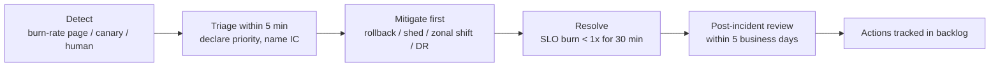

# 07. Incident command model

> Task 5 (15%). Selected cloud: AWS. Based on the Incident Command System (ICS) model used in SRE practice, adapted for a regulated bank.

## 1. Severity criteria

Priority follows customer and business impact as measured by the SLOs. If unsure, pick the higher priority. Downgrading later costs nothing.

| Priority | Criteria (any one) | Examples | Response |
|---|---|---|---|
| P1 Critical | 2+ CUJs in fast burn, any C0 shedding-class journey (login, transfer) failing for > 5% of customers for > 5 min, suspected data loss/integrity issue on the critical data set, confirmed security breach with customer impact, regional DR invoked | `apse5` impairment. Double-posting of transfers | IC paged immediately. All roles staffed. 24x7 until resolved. Exec + Risk informed in 15 min. |
| P2 Major | 1 CUJ in fast or slow burn, `AuroraGlobalDBRPOLag` > 180 s (RPO at risk), a provider fully down with fallback active, DR standby unhealthy (plan evaluation failing) | `ext-payment-switch` down, transfers pending | IC assigned within 15 min. Comms lead staffed. Business hours + on-call. |
| P3 Minor | Budget-leak alert, C2/C3 feature down, single-AZ issue absorbed by zonal shift | Statements export failing | Owning team handles in hours. No IC. |
| P4 Low | No customer impact. Risk only | Cert expiring in 14 days | Ticket |

Auto-declare: a composite alarm on 2+ CUJs in fast burn creates a P1 incident in the paging/ITSM tool and pages the IC rotation.

## 2. Roles

| Role | Does | Does not | Staffed by |
|---|---|---|---|
| Incident Commander (IC) | Owns the incident. Sets priorities, assigns roles, makes or delegates decisions (incl. DR invocation, [05 section 2](05-dr-runbook.md#2-authority-and-decision)), declares resolved | Debug or type commands | SRE IC rotation (trained. Seniority not required) |
| Ops / Tech lead | Leads technical investigation and mitigation. The only person directing changes to production | Talk to stakeholders | Owning team on-call or Platform for infra |
| Comms lead | Internal updates on cadence, status page, CX/branch briefing, exec updates | Make technical decisions | Rotation (SRE or service delivery) |
| Scribe | Timeline, decision log, action items in the incident record | - | Any trained engineer |
| Liaison - vendors | AWS Support case (Business-critical), `ext-payment-switch` / `ext-messaging` escalations, provider bridge | - | Vendor management on-call / Platform |
| Liaison - Risk & Compliance | Regulator notification assessment and submission (BNM RMiT), legal/PDPA view if data is affected | Technical work | Risk duty officer |
| SMEs | Join when asked by the Ops lead | Join uninvited and talk over the bridge | Any team |

Each incident has one IC, one Ops lead and one channel. The IC role can be handed over but is never shared.

## 3. Lifecycle



Mitigate before diagnosing. The standard first moves, in order: (1) did something change? Roll back. (2) Is it one AZ? Zonal shift. (3) Is it overload? Shed C2/C3 and turn on degraded mode. (4) Is it a provider? Breaker + pending mode. (5) Is it the Region? DR decision criteria.

## 4. Communication cadence

| Audience | P1 | P2 | Channel |
|---|---|---|---|
| Incident responders | Continuous | Continuous | Incident channel (Teams/Slack) + bridge |
| Internal stakeholders (Tech leadership, CX, branches) | Every 15 min | Every 30 min | Status template in channel + email |
| Executives | Initial <= 15 min, then every 30 min | Initial <= 30 min, then hourly | Exec channel / call |
| Customers | Status page + in-app banner within 20 min, then every 30 min | If customer-visible, every 60 min | Status page, app, social (Comms lead + CX) |
| Regulator | Risk/Compliance decides per BNM RMiT | Same | Formal channel (Risk owns) |
| Providers / AWS | As needed by the vendor liaison | Same | Provider bridge, AWS Support case |

Update template: *Impact* (who, what, since when), *Current status*, *Actions in progress*, *Next update at HH:MM*. "No change" is still an update.

## 5. Decision log

Kept by the scribe in the incident record (ITSM) and exported to the evidence bucket at close.

| Time (MYT) | Decision | Made by | Options considered | Signals / evidence | Expected effect | Revisit at |
|---|---|---|---|---|---|---|
| 10:42 | Declare P1 | IC (A. Tan) | P2 | CUJ-01 + CUJ-03 fast burn. Canaries red from `apse1` | Staff all roles | - |
| 10:49 | Roll back `transfer-svc` v2.14 -> v2.13 | Ops lead | Wait / scale out | Deploy at 10:38 correlates | Error rate dropping | 10:55 |
| 10:55 | Do not invoke DR | IC | Invoke | Error rate falling after rollback. D3 none | - | 11:05 |

Every rejected option is recorded with the reason it was rejected. Decisions with regulatory weight (DR invocation, customer comms wording, data-loss acceptance) are marked [R].

## 6. Evidence

| Evidence | Source | Preserved how |
|---|---|---|
| Timeline + decision log | ITSM incident record | Exported to `t1dx-incident-evidence/<incident-id>/` (S3 Object Lock, compliance mode, log-archive account) |
| AWS API activity | CloudTrail org trail | Already immutable in log-archive. Note the query used. |
| Metrics / dashboards at the time | CloudWatch, Grafana | Snapshot (PNG/JSON) + metric query links. CloudWatch keeps 15 months. |
| Logs and traces | CloudWatch Logs, `aws/spans` | Logs Insights query results exported. Log groups' retention extended for incident windows (legal hold if needed) |
| Changes | Deploy events, CAB records, Terraform plans | Linked in the record |
| AWS-side | AWS Health event IDs, Support case IDs | Linked |
| Chat | Incident channel export | Exported at close |
| DR / reconciliation | `t1dx-dr-validate` output, diff reports | Stored by the plan Lambda |

The IC checks the evidence before closing. The PIR cannot start until evidence is complete.

## 7. Escalation

| Time without acknowledgement / progress | Escalate to |
|---|---|
| Page not acked in 5 min | Secondary on-call (automatic) |
| Not acked in 10 min | Team engineering manager + IC rotation (automatic) |
| P1 not mitigated in 30 min | Head of Engineering / duty Head of Technology Operations |
| P1 > 60 min or DR invoked | CIO / CTO office, Risk head |
| AWS involvement suspected | AWS Support case at Business-critical system down (Enterprise: 15-min response). TAM. AWS Incident Detection and Response if subscribed |
| Provider involvement | Provider's P1 line per contract. Escalate to the provider's account manager at 30 min. |

## 8. Handover

For long incidents the IC and Ops lead hand over at 4 h at the latest, or earlier if tired.

```
HANDOVER - INC-<id> - <HH:MM MYT>
From: <name/role>        To: <name/role>
Priority: Px   Customer impact now: <who/what>   Since: <time>
Current hypothesis: <...>
Mitigations in place (and how to undo): <...>
In-flight actions + owners + ETA: <...>
Decisions pending: <...>   Next comms due: <HH:MM>
Risks / don't-do list: <e.g. do NOT restart MSK brokers; reconciliation job running>
Open vendor cases: AWS <id>, Provider A <ref>
```

The outgoing person stays on the bridge for 15 min after handover. The new IC announces "I am IC" in the channel.

## 9. After the incident

| Item | Standard |
|---|---|
| Post-incident review (PIR) | P1/2: within 5 business days. Blameless format. Includes timeline, impact (error budget consumed), contributing factors, what went well, what was lucky. |
| Actions | Each has an owner, a due date and a priority. P1 actions due <= 30 days. Tracked at the monthly reliability review. |
| Learning | Patterns across PIRs (e.g. "change-related") feed the roadmap's risk scores |
| Metrics | MTTD, MTTA, MTTM (mitigate), MTTR per priority. % actions closed on time |

## 10. Training and readiness

- IC training: 2 shadow shifts + 1 game day as IC before joining the rotation.
- Monthly 30-min "wheel of misfortune" (replay a past incident).
- On-call health: max 2 pages per shift as a target. Follow-the-sun not available, so 1-week rotations with compensatory time off.

## 11. Security, cost, ownership

| | |
|---|---|
| Security | The incident channel is limited to the roster on the incident. Customer data stays out of chat and tickets, people quote reference IDs instead. Evidence goes to `t1dx-incident-evidence` with Object Lock. |
| Cost | Mostly people time. Paging and ITSM use the bank's existing tool. On-call gets compensatory time off (section 10). |
| Ownership | SRE owns this process and the IC rotation. The owning team supplies the Ops lead. Risk duty officer owns the regulator view. |
