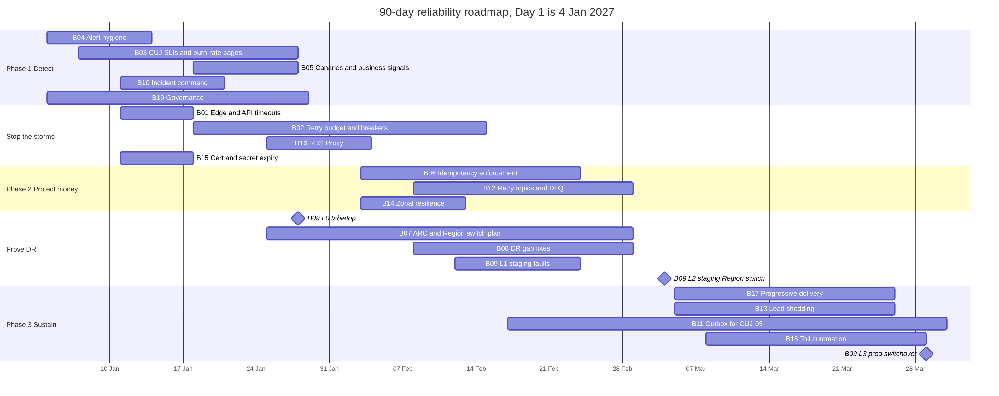

# 08. Prioritised 90-day reliability roadmap

> Task 6 (10%). Selected cloud: AWS. Example calendar: Day 1 = Mon 4 Jan 2027 -> Day 90 = Sat 3 Apr 2027.
> The risk and toil numbers are an illustrative baseline (assumption A9). Week 1 replaces them with real data, using the method in section 1.

## 1. Inputs and scoring method

Risk data = FMEA risk priority numbers from [01 section 3](01-reliability-model.md#3-failure-modes-fmea), recalculated from:
- Incident records (last 12 months): count and duration per failure mode, error budget consumed.
- Alarm history (`DescribeAlarmHistory`) + paging tool stats: alert volume and action rate.
- Region switch plan evaluation findings and game-day results.

Toil data = hours/week of manual, repetitive, automatable work:
- Collected in week 1 from Jira labels (`toil`), on-call logs and a 2-week self-reported time sample.

Illustrative toil baseline (SRE team of 4 = 160 h/week)

| Toil source | h/week |
|---|---|
| Triaging noisy / non-actionable alerts | 30 |
| Ops tickets from product teams (config changes, access, "can you check...") | 25 |
| Babysitting manual deploys and rollbacks | 12 |
| Restarting stuck consumers / clearing poison messages | 8 |
| Investigating suspected duplicate payments | 6 |
| Incident coordination without defined roles | 6 |
| Manual reports | 5 |
| Cert / secret renewals | 4 |
| Total | 96 h (60%) - SRE is already an ops dumping ground |

Priority score

```
score = ( RPN reduction / 10  +  0.3 x toil hours saved per week ) / effort      effort: S = 1, M = 2, L = 3 (sprints)
x 1.5 if the item addresses a failure mode that has already caused a P1 (repeat-incident multiplier)
```

Mandatory regardless of score: DR items (B07, B08, B09). The constraint says DR has never been exercised end to end. For a Tier 1 bank service, this is a regulatory exposure. Governance (B19) is also mandatory as the other items depend on it.

## 2. Scored backlog

| Rank | ID | Item | Failure mode | RPN reduction | Toil saved h/wk | Effort | Score | Owner |
|---|---|---|---|---|---|---|---|---|
| 1 | B04 | Alert hygiene: delete or downgrade non-actionable alarms | F4 | 8 | 15 | S | 5.30 | SRE |
| 2 | B02 | Shared client lib: single-layer retries, 10% retry budget, jitter, breakers + bulkheads (payment, messaging) | F1, F5 | 45 | 2 | M | 2.55 x 1.5 = 3.83 | SRE + Payments |
| 3 | B15 | Cert and secret expiry alarms + rotation | F16 | 24 | 4 | S | 3.60 | Platform |
| 4 | B03 | CUJ SLIs (access-log metric filters) + multi-window burn-rate paging | F4 | 40 | 10 | M | 3.50 | SRE |
| 5 | B06 | Enforce `Idempotency-Key` on `POST /transfers`. Provider status check before retry | F6 | 45 | 6 | M | 3.15 | Payments |
| 6 | B01 | Edge/API timeouts: CloudFront origin attempts = 1, API GW integration 8 s, deadline header | F1 | 20 | 0 | S | 2.00 x 1.5 = 3.00 | Platform |
| 7 | B17 | Progressive delivery gated on burn rate (auto-rollback) | F13 | 20 | 12 | M | 2.80 | Platform + teams |
| 8 | B10 | Incident command: IC rotation, roles, templates, auto-P1 | F4 | 10 | 6 | S | 2.80 | SRE |
| 9 | B16 | RDS Proxy + connection pool limits (`auth-svc`, `transfer-svc`) | F9 | 24 | 1 | S | 2.70 | Platform |
| 10 | B05 | Synthetics canaries in both Regions + business-signal anomaly alarms | F4, F12 | 20 | 1 | S | 2.30 | SRE |
| 11 | B12 | Retry topics + DLQ + rate-limited replay tool | F11 | 18 | 8 | M | 2.10 | Payments + SRE |
| 12 | B14 | PDB / topology spread / zonal autoshift / Karpenter zonal shift | F12 | 16 | 1 | S | 1.90 | Platform |
| 13 | B07 | ARC routing controls + Region switch plan `t1dx-region-switch` + `t1dx-dr-validate` | F3 | 50 | 0 | L | 1.67, mandatory | SRE + Platform |
| 14 | B08 | DR gaps: ECR/Secrets replication, provider EIP allowlist, ODCR, quotas in `apse1` | F3 | 30 | 0 | M | 1.50, mandatory | Platform |
| 15 | B18 | Automate top ops tickets (SSM Automation runbooks, self-service) | toil | 0 | 10 | M | 1.50 | SRE |
| 16 | B13 | Priority load shedding + degraded-mode flags | F1, F14 | 18 | 0 | M | 0.90 x 1.5 = 1.35 | Teams + SRE |
| 17 | B09 | Game days L0 -> L3 ([06](06-game-day-plan.md)) | F3, F2 | 25 | 0 | M | 1.25, mandatory | SRE |
| 18 | B11 | Transactional outbox for `transfer-svc` (MSK off the sync path) | F10, F5 | 15 | 1 | L | 0.60, enabler for DR reconciliation | Payments |
| - | B19 | Governance: error budget policy, PRR, SRE engagement charter, monthly reliability review | all | - | 25 (ops tickets returned to owners) | S | mandatory | Head of Eng + SRE |

## 3. Plan by phase



Source: [`diagrams/src/roadmap-gantt.mmd`](../diagrams/src/roadmap-gantt.mmd) (Mermaid gantt, rendered with `mmdc`).

| Phase | Days (dates) | Theme | Exit criteria |
|---|---|---|---|
| 1. See and stop the bleeding | 1-30 (4 Jan - 2 Feb 2027) | Detection, retry-storm fixes on the edge, governance agreed | Burn-rate pages live for CUJ-01..04, >= 50% of noisy alarms removed, CloudFront/API GW timeouts changed, error budget policy signed by the Head of Engineering, IC rotation staffed, L0 tabletop done (Day 25) |
| 2. Protect money, build DR | 31-60 (3 Feb - 4 Mar 2027) | Retry budget + breakers everywhere, idempotency, DR automation | Retry amplification <= 1.25x in L1a, `Idempotency-Key` enforced, Region switch plan evaluates clean, L2 staging Region switch <= 25 min (Day 60) |
| 3. Prove and sustain | 61-90 (5 Mar - 3 Apr 2027) | Production proof, safer change, toil down | L3 production switchover + failback (Day 85), burn-rate-gated deploys on `transfer-svc`, SRE toil <= 40%, quarterly DR calendar agreed |

## 4. Balancing reliability with delivery capacity

| Group | Capacity for reliability in these 90 days | Why it is affordable |
|---|---|---|
| SRE (4) | 100% on this roadmap, toil capped at 50% (target <= 40% by Day 90) | Toil drops from about 96 h to about 50 h/week as B04, B03, B18 and B19 land |
| Platform team | 30% | Most items are configuration of existing AWS services (CloudFront, API GW, ARC, Karpenter) |
| Payments / Auth product teams | 20% of sprint capacity (standard error-budget allowance) | Rises only if the error budget policy says so (section 5) |
| Other product teams | 10% (instrumentation, PRR fixes) | - |

Items are sequenced so product teams only carry 2 items each at a time. The big code change (B11 outbox) is spread across 6 weeks.

## 5. Governance to keep SRE out of the dumping ground

| Mechanism | Rule |
|---|---|
| SRE engagement charter | SRE works on: SLO framework, observability standards, incident command, resilience patterns, DR and game days, toil automation. SRE does not do: service feature work, other teams' tickets, access requests or "please check prod for me". |
| Toil cap | SRE toil <= 50% (measured monthly). Above 50% for 2 months -> ops work is handed back to the owning teams and the Head of Engineering is informed. |
| Intake | All requests go through the SRE Jira board with a category (`toil`, `project`, `consult`). No work from DMs. Monthly report of where SRE time went. |
| Production Readiness Review (PRR) | SRE supports a service's on-call escalations only if it passes the PRR: SLOs defined, burn-rate alerts, runbooks, dashboards, Application Signals service map, load test, DR role defined. |
| Handback rule | If a service consumes > 2x its error budget for 2 consecutive months and its team does not prioritise fixes, SRE support drops to "consult only" until it does. Agreed by the Head of Engineering. |
| Error budget policy | [02 section 4](02-sli-slo-specification.md#4-error-budget-policy). The remaining budget decides between feature work and reliability work. |
| Monthly reliability review | Chair: Head of Engineering. Inputs: SLO attainment, budget states, top incidents, toil %, roadmap status. Outputs: priority changes, freezes, escalations. |
| Quarterly DR review | With Risk: game-day results, RTO/RPO measured vs target, open DR gaps |

## 6. Metrics (with targets)

| Metric | Baseline (assumed) | Day 30 | Day 60 | Day 90 |
|---|---|---|---|---|
| CUJ SLO attainment (CUJ-01..03a) | Not measured | Measured | >= 99.95% | >= 99.99% trend |
| MTTD, customer-impacting (P1/2) | > 15 min | <= 10 min | <= 5 min | <= 5 min |
| MTTM (mitigate), P1 | Unknown | Measured | <= 30 min | <= 20 min |
| Pages per on-call shift | ~10 | <= 5 | <= 3 | <= 2 |
| % actionable pages | < 30% | >= 50% | >= 70% | >= 80% |
| Retry amplification under provider fault | 27x (theoretical) | - | <= 1.25x (L1a) | <= 1.25x |
| DR: measured RTO / RPO | Never tested | L0 done | L2 <= 25 min | L3 prod switchover done, RPO 0 |
| Region switch plan evaluation | n/a | Created | Clean | Clean 30 days |
| SRE toil % | 60% | <= 55% | <= 50% | <= 40% |
| Change failure rate (`transfer-svc`) | Unknown | Measured | - | -30% |
| PIR actions closed on time | Unknown | Measured | >= 70% | >= 85% |

## 7. Risks to the roadmap

| Risk | Mitigation |
|---|---|
| Data residency blocks DR in Singapore (A3) | Raise with Risk in week 1. It is the biggest dependency for B07-B09. |
| Product teams cannot release 20% capacity | Error budget policy makes it non-negotiable when the budget is burnt. Head of Engineering sponsors it. |
| Provider will not support idempotency keys | Adapter switches to "never retry. Status query + reconciliation" (assumption A2) |
| L3 production test is vetoed as too risky | Run L3 with graceful switchover (RPO 0). Show L2 evidence and the abort plan. |
| Real data changes priorities | Expected. Re-score in week 1 and at Day 30 and Day 60. |

## 8. Security, cost, ownership

| | |
|---|---|
| Security | B15 (cert and secret expiry) and B08 (Secrets Manager and ECR replication to `apse1`) are the security items. Every other item keeps the controls in [00 section 4](00-architecture-overview.md#4-security-controls-by-trust-boundary). |
| Cost | The main cost is people, set out in section 4. AWS spend added by this plan is mostly the warm standby, ODCR and ARC, see [00 section 6](00-architecture-overview.md#6-cost-order-of-magnitude-to-verify-in-aws-pricing-calculator). |
| Ownership | Each backlog item has an owner in section 2. The Head of Engineering chairs the monthly review and owns the trade-offs. |
